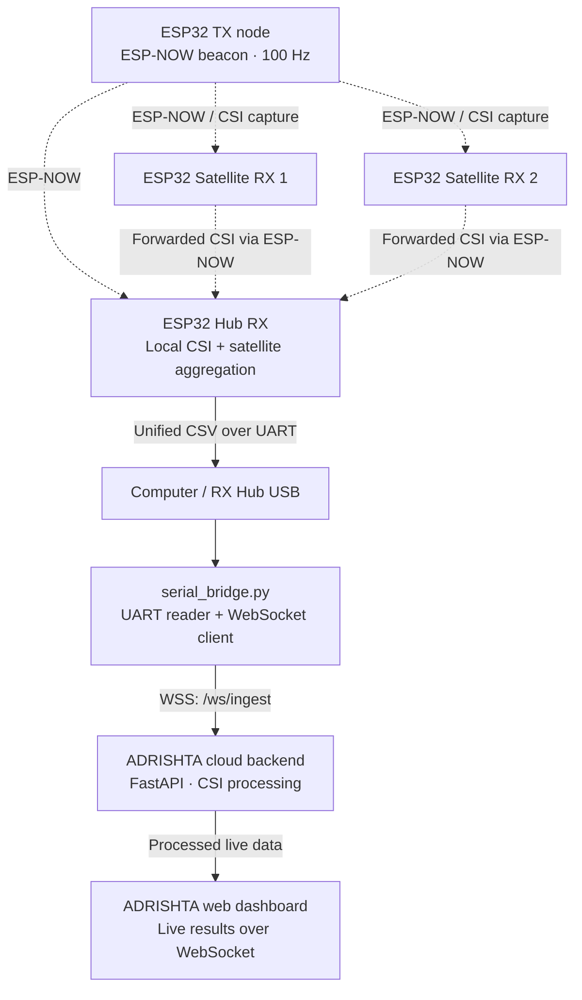
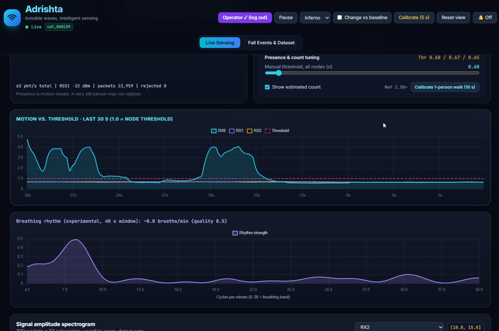
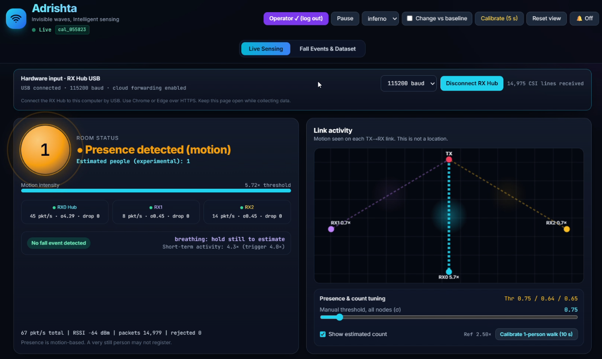
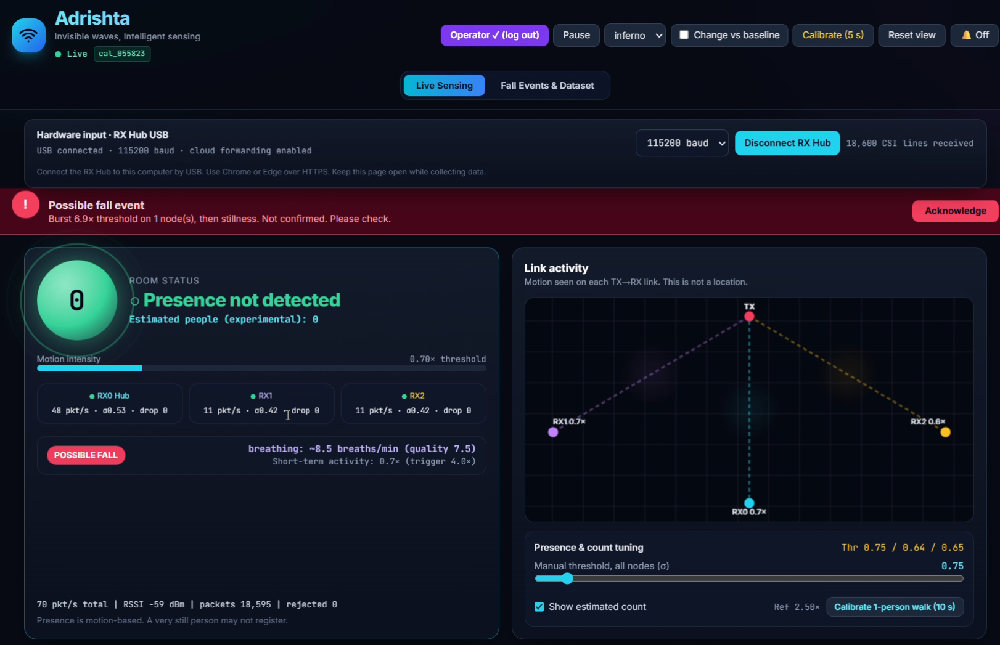
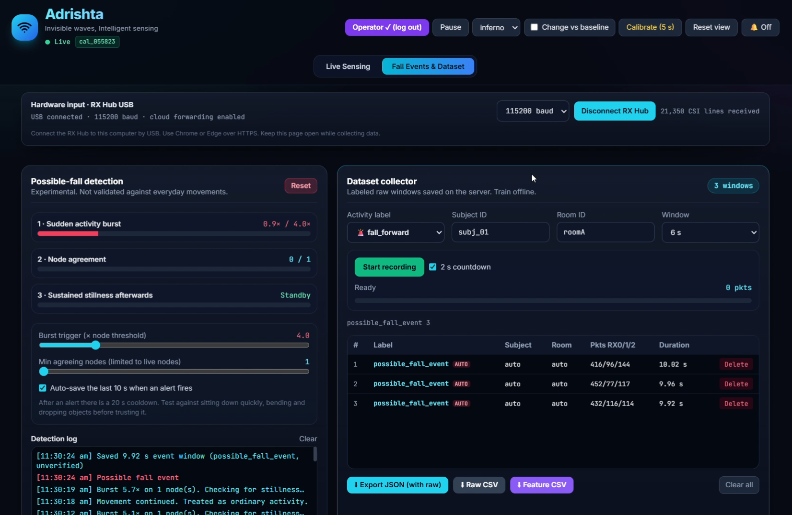

# ADRISHTA — Multi-Node Wi-Fi CSI Sensing Platform

**Invisible waves. Intelligent sensing.**

ADRISHTA is an experimental, contactless sensing platform built around **Wi-Fi Channel State Information (CSI)**. A distributed ESP32 network captures changes in the wireless channel caused by movement in an indoor environment. The captured CSI is transported to a cloud backend, where the processing pipeline derives live sensing metrics and makes the results available through a web dashboard.

- **Live dashboard:** [https://adrishta.live](https://adrishta.live)
- **Source code:** [github.com/gautamsharma2004/ADRISHTA](https://github.com/gautamsharma2004/ADRISHTA)
- **Firmware framework:** ESP-IDF 5.x
- **Wireless transport between nodes:** ESP-NOW
- **Hub-to-server transport:** UART serial bridge over secure WebSocket (WSS)
- **Backend:** Python / FastAPI
- **Deployment:** Vultr server, behind Nginx and HTTPS

> **Research/prototype status:** Presence, people-count estimation, breathing-rhythm estimation and possible-fall detection are experimental. They are not validated medical, emergency, or safety systems. Do not rely on ADRISHTA as the sole means of detecting a fall or requesting assistance.

---

## Contents

- [Overview](#overview)
- [System architecture](#system-architecture)
- [Hardware node roles](#hardware-node-roles)
- [Cloud deployment and data flow](#cloud-deployment-and-data-flow)
- [Dashboard features](#dashboard-features)
- [CSI data format](#csi-data-format)
- [UART commands](#uart-commands)
- [Hardware and software requirements](#hardware-and-software-requirements)
- [Firmware setup and flashing](#firmware-setup-and-flashing)
- [Cloud/server configuration](#cloudserver-configuration)
- [Running the serial bridge](#running-the-serial-bridge)
- [Dataset collection and export](#dataset-collection-and-export)
- [Limitations and validation](#limitations-and-validation)
- [Repository structure](#repository-structure)
- [Future work](#future-work)

## Overview

The system uses one transmitter and three receiving nodes:

1. A **TX node** periodically broadcasts ESP-NOW packets.
2. A **Hub RX node** captures its own CSI and receives CSI forwarded by the satellite nodes.
3. Two **Satellite RX nodes** independently capture CSI and forward selected packets to the hub.
4. The hub emits a unified UART stream to a computer.
5. A local serial bridge forwards the stream to the cloud backend through a secure WebSocket connection.
6. The backend performs CSI parsing and sensing calculations. The browser dashboard receives live results from the server.

This separates hardware acquisition from application processing. The ESP32 firmware remains responsible for packet transmission, CSI capture, forwarding and UART output; the cloud application handles the higher-level processing and dashboard data.

## System architecture



### End-to-end data path

`TX → RX nodes → Hub RX → UART → serial_bridge.py → WSS → cloud processing → dashboard`

The browser is a presentation and monitoring client. The CSI processing pipeline runs on the server rather than being exposed as client-side algorithm code.

## Hardware node roles

### 1. TX node (transmitter)

- **Role:** Acts as the wireless beacon that triggers CSI capture at the receiver nodes.
- **Firmware:** TX-node firmware.
- **Packet rate:** Configured to broadcast at approximately 100 Hz.
- **Wireless configuration:** Wi-Fi Channel 11, HT20, MCS0, LGI PHY rate.
- **Purpose:** Provides a consistent packet source for the receiving nodes.

### 2. Hub RX node (Node 0)

- **Role:** Central receiver and aggregation point.
- **Firmware:** `csi_rx_hub_main.c`.
- Captures CSI locally from the TX node.
- Receives CSI frames forwarded by Satellite RX 1 and Satellite RX 2 using ESP-NOW.
- Synchronizes timestamps and emits a unified CSV stream over UART.
- Accepts UART commands for configuration and diagnostics.
- Connects to the computer over USB/UART.

### 3. Satellite RX nodes (Nodes 1 and 2)

- **Role:** Distributed receivers placed at different positions in the monitored room.
- **Firmware:** `csi_rx_satellite_main.c`.
- Capture CSI from the TX node.
- Forward captured CSI to the Hub RX node over ESP-NOW.
- Forward every second packet (approximately 50 Hz from a 100 Hz source) to reduce wireless forwarding load.

The receiver nodes provide multiple spatial perspectives of the same environment. The link-activity visualization represents activity on the TX-to-RX links; **it is not a map and does not provide a person's physical location**.

## Cloud deployment and data flow

ADRISHTA is deployed as a publicly accessible website at **[adrishta.live](https://adrishta.live)**. The processing pipeline is hosted on a cloud server rather than being delivered as browser-side algorithm code.

### Data flow

1. The Hub RX is connected to the acquisition computer through USB/UART.
2. `serial_bridge.py` reads the hub's UART stream.
3. The bridge forwards incoming CSI records to the backend using a secure WebSocket connection:
   `wss://adrishta.live/ws/ingest`
4. The cloud backend receives the stream and runs the CSI processing pipeline.
5. The website obtains live processed updates from the backend over WebSocket and renders the dashboard.

### Deployment components

| Component | Responsibility |
|---|---|
| ESP32 firmware | Packet transmission, CSI capture, inter-node forwarding and UART output |
| Acquisition computer | Runs the serial bridge and connects the hub to the internet |
| `serial_bridge.py` | Reads UART data and forwards it to the cloud ingestion WebSocket |
| FastAPI backend | Ingests CSI data and runs server-side processing |
| Processing engine | CSI parsing and sensing calculations, including motion/presence and experimental breathing/fall analysis |
| Nginx + HTTPS | Public web serving and secure reverse-proxy deployment |
| Web dashboard | Displays live results and provides controls for monitoring and data collection |

**Important:** The ESP32 nodes do not need to connect directly to the cloud. The Hub RX communicates with the acquisition computer over UART; the computer provides the network path to the server.

## Dashboard features

The dashboard is organized around live sensing and fall-event/dataset workflows.

### Live sensing

- Live receiver and packet statistics.
- RSSI and packet/rejection counters.
- Per-link activity for RX0, RX1 and RX2.
- Motion intensity and configurable presence threshold.
- Experimental estimated people count.
- Motion-versus-threshold history.
- Signal-amplitude spectrum visualization.
- Experimental breathing-rhythm estimate.
- Calibration, pause, reset-view and baseline-comparison controls.
- Optional alert notifications.

### Possible-fall monitoring

The fall-event panel exposes intermediate detection signals, including:

1. **Sudden activity burst** — detects a large short-term activity increase relative to the configured node threshold.
2. **Node agreement** — checks how many active receiver nodes agree with the event.
3. **Sustained stillness afterwards** — checks for a quiet period after the burst.

An alert is labelled **possible fall**, not a confirmed fall. The system can also save a short event window for later inspection.

### Dataset collection

The dataset collector supports labelled raw-window capture with fields such as:

- Activity label
- Subject ID
- Room ID
- Capture-window duration

Collected windows can be exported for offline analysis and model development. The dashboard provides raw JSON, raw CSV and feature CSV export options where enabled by the deployed application.

### Screenshots

#### Live sensing — motion and signal analysis



#### Live sensing — room status and receiver-link activity



#### Possible-fall event alert



#### Fall-event analysis and dataset collection



## CSI data format

The Hub RX emits a unified CSV record in the following format:

```csv
CSI_DATA,<rx_id>,<ms>,<rssi>,<sc0>,<sc1>,...,<sc51>
```

| Field | Description |
|---|---|
| `rx_id` | Receiver identifier: `0` = Hub RX, `1` = Satellite RX 1, `2` = Satellite RX 2 |
| `ms` | Hub-synchronized timestamp in milliseconds |
| `rssi` | Received Signal Strength Indicator |
| `sc0` … `sc51` | 52 CSI amplitude subcarrier values |

The stream is aggregated at the hub so the computer-side bridge can forward records through a single serial connection.

## UART commands

Send the following commands to the Hub RX using a serial terminal or the supported website/serial interface:

| Command | Description |
|---|---|
| `MAC_FILTER:0` | Disable strict MAC filtering |
| `MAC_FILTER:1` | Enable strict MAC filtering (default) |
| `RESET_STATS` | Reset internal debug counters |
| `STATUS` | Print current packet counts and system status |

Commands are sent to the Hub RX. They are not commands for the TX or satellite nodes.

## Hardware and software requirements

### Hardware

- 4 × ESP32 development boards:
  - 1 × TX
  - 1 × Hub RX
  - 2 × Satellite RX
- USB data cable for the Hub RX.
- USB power sources or power banks for the TX and satellite nodes as required by the deployment.
- Computer with a USB port and internet connectivity to run the serial bridge.

The firmware and pin/board configuration must match the exact ESP32 variant and project configuration being used.

### Software

- ESP-IDF v5.x.
- Python environment compatible with the serial bridge.
- USB/UART serial driver for the selected ESP32 development board.
- Modern Chromium-based browser (Chrome or Edge) for browser features that use Web Serial, where applicable.
- Internet access from the acquisition computer to reach the deployed backend.

## Firmware setup and flashing

### Step 1 — Flash the TX node

1. Open the TX firmware project in the ESP-IDF environment.
2. Build and flash it to the first ESP32.
3. Open the serial monitor and note the printed **TX NODE MAC** address.

Example format:

```text
64:E8:33:57:F9:20
```

Use the MAC address printed by your own board; the example above is only a format example.

### Step 2 — Configure the TX MAC address

1. Open the Hub RX and Satellite RX firmware source files.
2. Find the `TX_MAC` definition.
3. Update it with the MAC address obtained from the TX node.
4. Confirm the configured Wi-Fi channel and other radio settings are consistent across the nodes.

### Step 3 — Flash the Hub RX

1. Connect the second ESP32 to the computer.
2. Build and flash the Hub RX firmware (`csi_rx_hub_main.c`).
3. Open the serial monitor and confirm that the hub starts receiving CSI data.
4. Keep this board connected to the acquisition computer over USB/UART.

### Step 4 — Flash the Satellite RX nodes

1. Open `csi_rx_satellite_main.c`.
2. Set `SAT_NODE_ID` to `1` and flash the third ESP32.
3. Change `SAT_NODE_ID` to `2` and flash the fourth ESP32.
4. Power the satellite nodes and position them at the required receiver locations.
5. Verify that the hub receives forwarded data from both satellite IDs.

### Step 5 — Verify the unified UART stream

Connect to the Hub RX serial port at the configured baud rate (the dashboard screenshot shows **115200 baud**) and check that records from receiver IDs `0`, `1` and `2` are present.

## Cloud/server configuration

The public dashboard is hosted at:

- **Website:** [https://adrishta.live](https://adrishta.live)
- **CSI ingestion WebSocket:** `wss://adrishta.live/ws/ingest`

The deployed service uses a FastAPI application served by Uvicorn, with Nginx handling the public HTTPS-facing web deployment.

The ingestion bridge must be configured with the server's ingestion credential. In the deployed setup, the environment variable name is:

```text
ADRISHTA_INGEST_TOKEN
```

Server-side processing is intentional: the browser should consume the backend's live outputs rather than contain the private CSI-processing implementation.

## Running the serial bridge

The acquisition computer runs the serial bridge between the Hub RX and the cloud service.

At a high level, the bridge must:

1. Open the correct USB/UART serial device.
2. Use the baud rate configured for the Hub RX (115200 in the shown deployment).
3. Read complete CSI records from the serial stream.
4. Authenticate to the ingestion endpoint using the configured ingestion token.
5. Forward records to `wss://adrishta.live/ws/ingest`.
6. Reconnect and report errors if the serial device or network connection drops.

Run the bridge from the project directory using the command and options defined by the checked-in `serial_bridge.py` implementation. The exact serial-port argument and command-line flags depend on that script version; check its `--help` output or source before running it.


## Dataset collection and export

For a labelled capture:

1. Open the **Fall Events & Dataset** view.
2. Connect the RX Hub over USB if the browser-based USB capture path is being used, or ensure the serial bridge is forwarding data for the cloud workflow.
3. Select the activity label.
4. Enter a subject ID and room ID.
5. Select the capture-window duration.
6. Start recording and allow the capture to complete.
7. Review the saved window and export the required format.

Use consistent labels and subject/room identifiers across sessions. Keep a separate record of experimental conditions (receiver placement, room layout, distance, activity protocol and firmware version) so that exported data can be interpreted later.

## Limitations and validation

- **Presence is motion-based.** A very still person may not register as present.
- **People count is experimental.** It should not be treated as an accurate occupancy counter without a dedicated validation study.
- **Breathing-rhythm estimation is experimental.** The dashboard estimate can be affected by movement, multipath changes, receiver placement and environmental noise.
- **Fall detection is experimental and unverified.** Sudden ordinary movements can resemble a fall, and some falls may not trigger an alert. The dashboard explicitly treats an event as a possible fall rather than a confirmed event.
- **Link activity is not localization.** Receiver-link measurements do not directly provide coordinates or a person's physical location.
- **Performance depends on deployment.** Room geometry, interference, antenna orientation, node spacing, packet loss and human activity can change the CSI signal.

Before any real-world safety use, the detection pipeline requires systematic testing with representative users, activities, room layouts and failure cases. It must not replace a certified fall-detection or emergency-response system.

## Repository structure

The firmware and deployment filenames can vary as the project evolves. The principal components described in this README are:

```text
ADRISHTA/
├── TX firmware                 # ESP-NOW transmitter
├── csi_rx_hub_main.c           # Hub RX firmware
├── csi_rx_satellite_main.c     # Satellite RX firmware
├── serial_bridge.py            # UART-to-cloud WebSocket bridge
├── backend/
│   └── app/
│       ├── main.py             # FastAPI application / API and WebSocket endpoints
│       └── engine.py            # CSI processing engine
├── index.html                  # Web dashboard (deployment copy)
└── docs/
    └── images/
        ├── architecture1.png
        ├── architecture2.png
        ├── architecture3.png
        └── architecture4.png
```

This is a conceptual layout of the components referenced in the documentation, not a guarantee that every item is present at this exact path in every branch.

## Future work

Potential development directions include:

- Quantitative evaluation of presence and occupancy estimates.
- Fall-event dataset expansion and false-positive/false-negative analysis.
- Robust multi-node synchronization and packet-loss handling.
- Controlled breathing-estimation experiments and signal-quality scoring.
- Offline training and evaluation of activity/fall classification models.
- Automated deployment, service monitoring and structured backend logging.
- Reproducible experiments across different room layouts and receiver placements.

---

## License and contributions


For bugs, questions or technical discussion, open an issue in the [ADRISHTA GitHub repository](https://github.com/gautamsharma2004/ADRISHTA).
